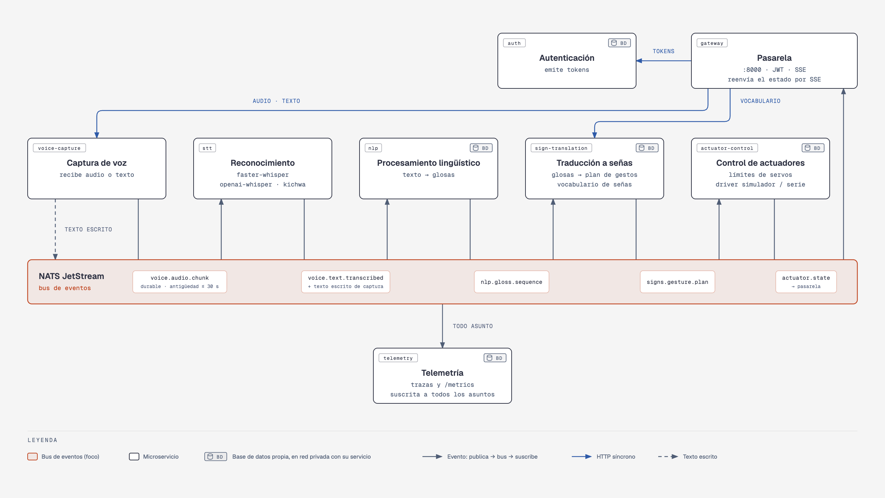
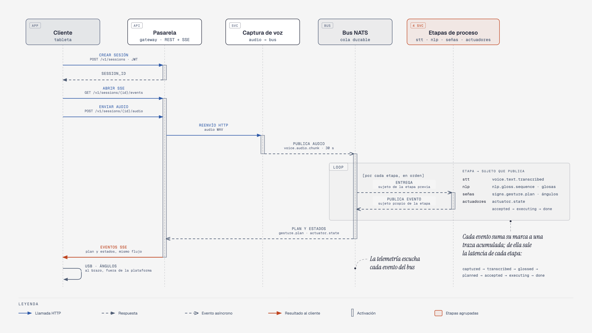
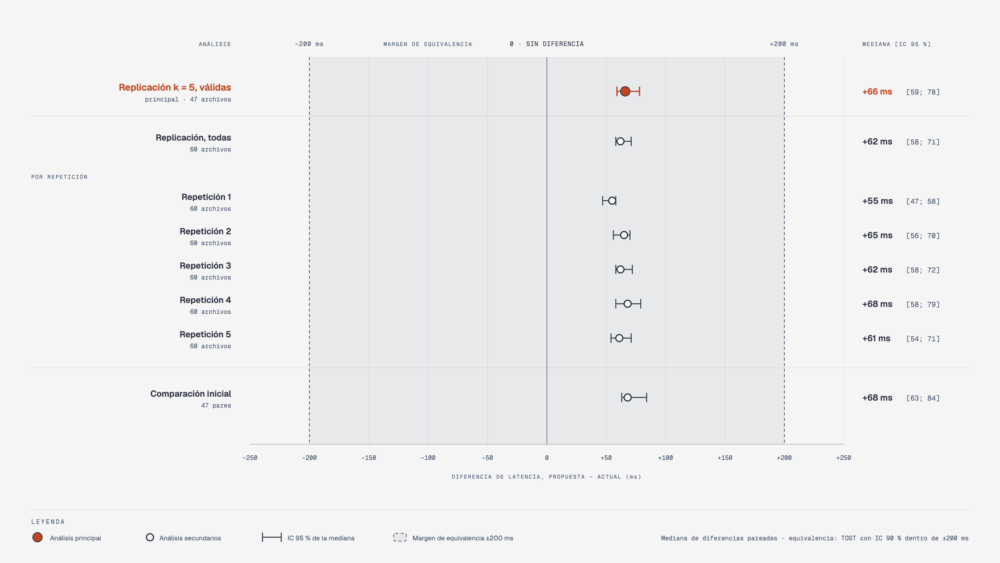

# Brazo robótico de señas — plataforma de microservicios

[](LICENSE)
[](LICENSE-DATA.md)


Plataforma de software que convierte voz o texto en español en una secuencia de señas y la envía a un brazo robótico de 15 servomotores. Organiza el sistema en ocho microservicios, uno por capacidad del dominio, comunicados por eventos con contratos explícitos, y mide cada sesión de extremo a extremo con una traza de tiempos embebida en los eventos.

Este repositorio es el material de réplica del artículo *Diseño de una arquitectura de referencia basada en microservicios para sistemas robóticos de traducción de voz a lengua de señas* (Wachapa Yankur y Timbi Sisalima, Universidad Politécnica Salesiana). Contiene el código, los contratos, las decisiones de arquitectura, los guiones de evaluación y los resultados crudos.

<p align="center">
  
</p>

## Contenido

- [Características](#características)
- [Arranque rápido](#arranque-rápido)
- [Uso de la API](#uso-de-la-api)
- [Resultados de la evaluación](#resultados-de-la-evaluación)
- [Documentación](#documentación)
- [Estructura del repositorio](#estructura-del-repositorio)
- [Réplica de los experimentos](#réplica-de-los-experimentos)
- [Cómo citar](#cómo-citar)
- [Licencia](#licencia)

## Características

| | |
|---|---|
| **Servicios por capacidad** | Captura de voz, reconocimiento, procesamiento lingüístico, traducción a señas, control de actuadores y telemetría, detrás de una pasarela con autenticación. |
| **Eventos con contrato** | Seis asuntos de NATS JetStream descritos en AsyncAPI ([`contracts/asyncapi.yaml`](contracts/asyncapi.yaml)); el ingreso de audio es durable. |
| **Motores intercambiables** | Reconocimiento con *faster-whisper*, *openai-whisper* u otros proveedores; *driver* del brazo simulado o serie. Cambiar de uno a otro es configuración. |
| **Vocabulario como servicio** | Las señas se crean y editan por API, sin recompilar ni redesplegar el cliente. |
| **Datos por servicio** | Cada servicio con estado tiene su propia base PostgreSQL en una red privada ([ADR-014](docs/adr/ADR-014-base-de-datos-por-servicio.md)). |
| **Observabilidad** | Traza de siete marcas por sesión, `/metrics` en todos los servicios y un tablero de Grafana. |
| **Seguridad en el borde** | Un solo puerto público, JWT con roles y cada sesión visible solo para quien la creó. |

## Arranque rápido

Requisitos: Docker con Compose v2 y Python 3.11.

```bash
cp .env.example .env
# AUTH_SECRET y BUS_TOKEN son obligatorios:
sed -i.bak "s/^AUTH_SECRET=.*/AUTH_SECRET=$(openssl rand -hex 32)/; s/^BUS_TOKEN=.*/BUS_TOKEN=$(openssl rand -hex 32)/" .env

docker compose up --build -d          # 16 contenedores; brazo simulado y reconocimiento «echo»
python scripts/e2e_demo.py "hola mamá"
```

La pasarela queda en `http://localhost:8080`, con documentación interactiva en `/docs`, y Grafana en `http://localhost:3000`. Si el puerto 8080 está ocupado, use `GATEWAY_PORT=8081`. La [guía de operación](docs/operacion.md) cubre el reconocimiento con Whisper, el brazo real por USB y la ejecución sin Docker.

## Uso de la API

Una sesión se crea, se escucha por *Server-Sent Events* y recibe texto o audio; el plan de gestos y los estados del actuador llegan por el mismo flujo.

```bash
API=http://localhost:8080
TOKEN=$(curl -s -X POST $API/auth/token -H 'content-type: application/json' \
  -d '{"username":"operator","password":"operator123"}' | jq -r .access_token)
SID=$(curl -s -X POST $API/v1/sessions -H "authorization: Bearer $TOKEN" | jq -r .session_id)

curl -N $API/v1/sessions/$SID/events -H "authorization: Bearer $TOKEN" &        # flujo SSE
curl -s -X POST $API/v1/sessions/$SID/text -H "authorization: Bearer $TOKEN" \
  -H 'content-type: application/json' -d '{"text":"hola","language_hint":"es"}'
curl -s -X POST $API/v1/sessions/$SID/audio -H "authorization: Bearer $TOKEN" -F file=@audio.wav
```

<p align="center">
  
</p>

## Resultados de la evaluación

La plataforma se evaluó con once escenarios de atributos de calidad, más uno exploratorio de escalabilidad, ejecutados como experimentos reproducibles en un solo equipo. Resultados principales:

| Escenario | Resultado |
|---|---|
| Latencia frente al sistema anterior, con el mismo código de reconocimiento | **+66 ms** en la mediana (IC 95 % 59–78), equivalente dentro de ±200 ms; replicación con plan registrado, 600 mediciones |
| Latencia de software con voz (*faster-whisper base*, CPU) | p95 de **584 ms**, con una meta de 1 500 ms |
| Sustituir el motor de reconocimiento | 3 archivos de un servicio, frente a 10 en dos unidades |
| Añadir 10 señas | 25 ms por API; 0 recompilaciones y 0 despliegues |
| Caída del reconocimiento | El modo texto respondió en 30 de 30 cortes; se procesaron 27 de 30 audios |
| Peticiones sin credencial o sin rol | 60 de 60 rechazadas con 401 y 8 de 8 con 403 |

<p align="center">
  
</p>

El detalle, con todas las gráficas y sus límites, está en [docs/evaluacion.md](docs/evaluacion.md).

## Documentación

| Documento | Contenido |
|---|---|
| [Arquitectura](docs/arquitectura.md) | Objetivos, contexto, contenedores, ejecución, despliegue y conceptos transversales |
| [Decisiones (ADR)](docs/adr/) | Catorce registros de decisiones con sus alternativas y consecuencias |
| [Escenarios de calidad](docs/escenarios-de-calidad.md) | Los doce escenarios QA-01 a QA-12 y cómo se miden |
| [Evaluación](docs/evaluacion.md) | Resultados por escenario, gráficas y amenazas a la validez |
| [Operación](docs/operacion.md) | Configuración, despliegue, observabilidad, seguridad y solución de problemas |
| [Contratos de eventos](contracts/asyncapi.yaml) | Especificación AsyncAPI de los seis asuntos del bus |

Índice completo en [docs/README.md](docs/README.md).

## Estructura del repositorio

```
services/<servicio>/   código, pruebas, Dockerfile y dependencias de cada microservicio
libs/rsp_common/       contratos de eventos, cliente del bus, servicio base y autenticación
contracts/             especificación AsyncAPI
monitoring/            configuración de Prometheus y tablero de Grafana
scripts/               evaluación, análisis estadístico, demostraciones y utilidades
results/               datos crudos de cada experimento, con su entorno y commit
data/                  datos de ejemplo y manifiestos de los corpus de voz
docs/                  arquitectura, decisiones, escenarios, evaluación y operación
```

## Réplica de los experimentos

```bash
scripts/run_evaluation.sh              # evaluación completa de la plataforma
scripts/run_baseline_states.sh         # estados de comparación
scripts/run_replica_qa01.sh            # replicación de QA-01 según docs/plan-replica-qa01.md
scripts/generate_audio_corpus.sh       # regenera los corpus de voz (macOS)
```

Los resultados del artículo se obtuvieron con el vocabulario de señas y el diccionario kichwa originales, que no se distribuyen; los archivos de [`data/`](data/README.md) son datos de ejemplo con el mismo formato. Cada archivo de [`results/`](results/) registra el *commit* de los instrumentos y del sistema medido. Este repositorio es una instantánea sin historial del repositorio de desarrollo; los *commits* citados en el artículo pertenecen a ese historial.

## Cómo citar

Use los metadatos de [`CITATION.cff`](CITATION.cff); GitHub los muestra en «Cite this repository».

## Licencia

Código bajo licencia [MIT](LICENSE). Datos, resultados y documentación propios bajo [CC BY 4.0](LICENSE-DATA.md).

Prototipo de investigación: antes de usarlo en un entorno real, revise la seguridad de su despliegue.
