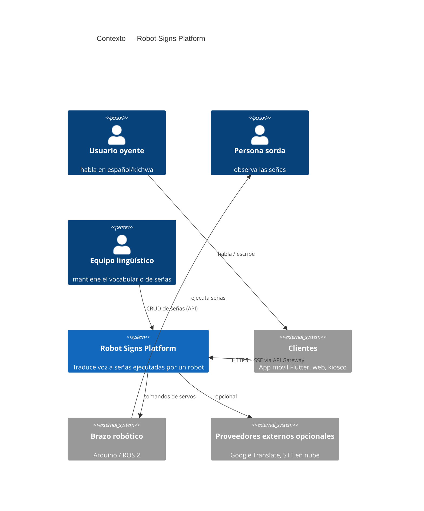
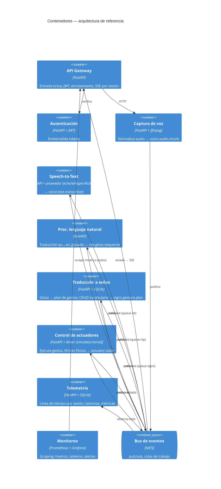
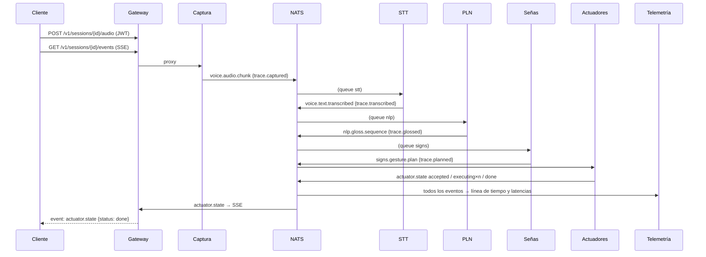
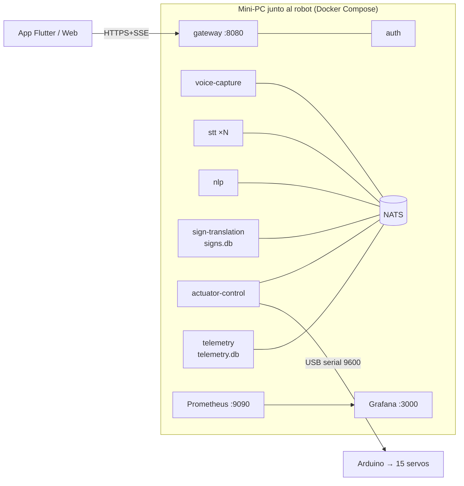

# Arquitectura de referencia — Robot Signs Platform (RSP)

Documento de arquitectura (estructura arc42 abreviada) de la **arquitectura de referencia basada en microservicios para sistemas robóticos de traducción de voz a lengua de señas**, y de su instancia concreta: el prototipo de este repositorio, aplicado al brazo robótico de la Universidad Católica de Cuenca.

> Arquitectura de referencia ≠ arquitectura concreta. La primera (§4–§6) es abstracta y reutilizable por cualquier robot asistivo que traduzca voz a gestos; la segunda (§7) es la instancia que se evalúa en la tesis. Cada decisión está registrada en `docs/adr/`.

## 1. Introducción y objetivos

**Objetivo:** desacoplar las etapas del pipeline voz → gesto para que cada una pueda sustituirse, escalarse y observarse de forma independiente, corrigiendo los problemas P1–P11 detectados en el sistema heredado (`docs-tesis/01-analisis-as-is-y-diagnostico.md`).

**Atributos de calidad prioritarios** (ISO/IEC 25010), en orden:

| Prioridad | Atributo | Por qué importa en este dominio |
|---|---|---|
| 1 | Modificabilidad | Motores de STT/traducción y hardware cambian más rápido que el sistema |
| 2 | Rendimiento (latencia) | Una conversación tolera ~1 s de retardo; más rompe la interacción |
| 3 | Interoperabilidad | Clientes heterogéneos (móvil, web, kiosco) y hardware heterogéneo (Arduino hoy, ROS 2 mañana) |
| 4 | Observabilidad / analizabilidad | Sin telemetría no hay evaluación ni diagnóstico en campo |
| 5 | Disponibilidad | Un fallo en ML no debe dejar el robot inerte |
| 6 | Seguridad | Secretos fuera de los clientes; acceso autenticado a actuadores |

## 2. Restricciones

- Hardware existente: brazo de 15 servos con firmware Arduino y protocolo serial sin ACK (no modificable a corto plazo).
- Despliegue objetivo: mini‑PC/laptop junto al robot (edge), con Docker; sin dependencia de nube salvo proveedores opcionales.
- Equipo pequeño; lenguaje único (Python) para reducir fricción (ADR‑001).
- El vocabulario de señas lo mantiene personal no técnico.

## 3. Contexto (C4 nivel 1, to‑be)

## 4. Vista de contenedores (C4 nivel 2) — la arquitectura de referencia

### 4.1 Catálogo de servicios

| Servicio | Responsabilidad única | Consume | Produce | Datos propios | Escala |
|---|---|---|---|---|---|
| API Gateway | Frontera: auth, enrutamiento, SSE, salud agregada | HTTP clientes; `actuator.>`, `nlp.>`, `signs.>` | HTTP | — | horizontal |
| Autenticación | Identidad y tokens | HTTP | JWT | usuarios (env / IdP) | horizontal |
| Captura de voz | Ingesta y normalización de audio/texto | HTTP | `voice.audio.chunk` | — | horizontal |
| Speech‑to‑Text | Audio → texto (proveedor intercambiable) | `voice.audio.chunk` (queue `stt`) | `voice.text.transcribed` | caché de modelos | horizontal por cola |
| PLN | Traducción y glosado | `voice.text.transcribed` (queue `nlp`) | `nlp.gloss.sequence` | diccionarios | horizontal |
| Traducción a señas | Glosa → gestos; vocabulario | `nlp.gloss.sequence` (queue `signs`) | `signs.gesture.plan` | BD de señas | horizontal |
| Control de actuadores | Ejecución segura en hardware | `signs.gesture.plan` | `actuator.state` | modelo del hardware | 1 por robot |
| Telemetría | Registro y medición | todos los asuntos | métricas, API | BD de eventos | 1 (o particionado) |
| Monitoreo | Tableros y alertas | `/metrics` | — | series temporales | — |

**Regla de oro de la referencia:** un servicio es dueño de exactamente un tipo de conocimiento (el hardware, el vocabulario, el motor de voz…) y lo expone solo a través de su contrato. El conocimiento del hardware, por ejemplo, existe únicamente en Control de actuadores (antes estaba copiado en tres archivos).

## 5. Vista de tiempo de ejecución

Cada evento arrastra `trace` (marcas de tiempo por etapa): la latencia end‑to‑end y por etapa se obtiene sin instrumentación adicional ni relojes sincronizados entre máquinas (todas las marcas las pone el productor; con varios hosts se requiere NTP, ver amenazas a la validez).

## 6. Conceptos transversales

- **Contratos primero** (`libs/rsp_common/events.py`, `contracts/asyncapi.yaml`): los esquemas Pydantic son el contrato; un cambio incompatible exige nuevo asunto versionado (`voice.text.transcribed.v2`).
- **Colas de trabajo NATS** para las etapas pesadas (STT): `STT_REPLICAS=3` reparte la carga sin cambios de código.
- **Salud y métricas uniformes**: todo servicio expone `/health` y `/metrics` (Prometheus) a través de `rsp_common.service.Service`.
- **Seguridad en el borde**: solo el gateway se publica; JWT HS256 en el prototipo, sustituible por OIDC (Keycloak) sin tocar servicios.
- **Degradación controlada**: si STT cae, los eventos quedan en NATS y el resto sigue vivo; el gateway informa `degraded`. Modo texto permite operar sin STT.
- **Proveedores como estrategia**: STT (`echo|whisper|kichwa`), traducción (`none|google|dictionary`), actuador (`simulator|serial`). Añadir uno = una clase.

## 7. Vista de despliegue (instancia)

## 8. Decisiones de arquitectura

Ver `docs/adr/` (ADR‑001 … ADR‑008). Las más determinantes: microservicios con un solo lenguaje (001), NATS como bus (002), pipeline por eventos con `trace` (003/004), un único dueño del hardware (005), gateway como frontera de seguridad (006).

## 9. Riesgos y deuda técnica

| Riesgo | Mitigación |
|---|---|
| Protocolo serial sin ACK: "done" significa "enviado", no "ejecutado" | Telemetría lo marca como `driver=serial`; trabajo futuro: firmware con ACK/lectura de posición |
| SQLite por servicio no soporta réplicas concurrentes del mismo servicio | Suficiente para un robot; migrar a PostgreSQL si se replica Señas/Telemetría |
| Whisper en CPU puede superar 1 s | `STT_REPLICAS`, modelos `base/tiny`, o GPU; medir en QA‑01 |
| Reglas de glosado simplificadas | Explicitado como fuera de alcance; el contrato permite sustituir el PLN por un modelo completo de LSEC |

## 10. Glosario

**Glosa**: etiqueta en mayúsculas que nombra una seña. **Dactilología**: deletreo con el alfabeto manual. **Plan de gestos**: secuencia ordenada de posiciones objetivo de servos. **Trace**: marcas de tiempo por etapa que viajan dentro de cada evento.
