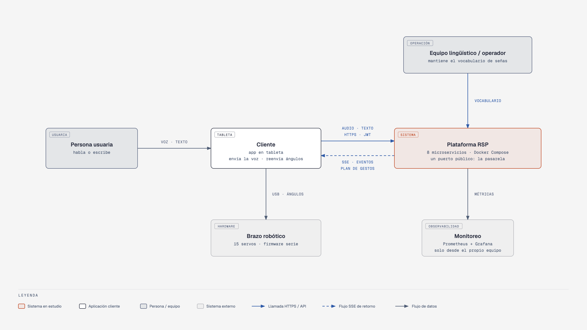
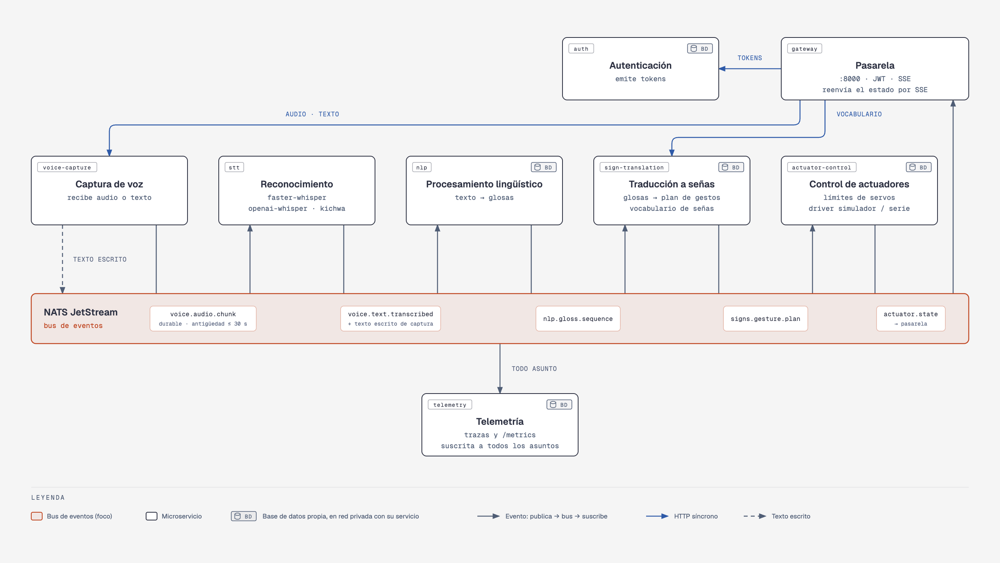
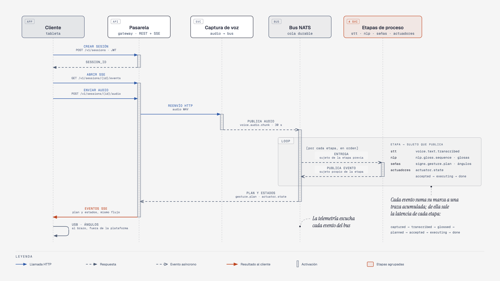
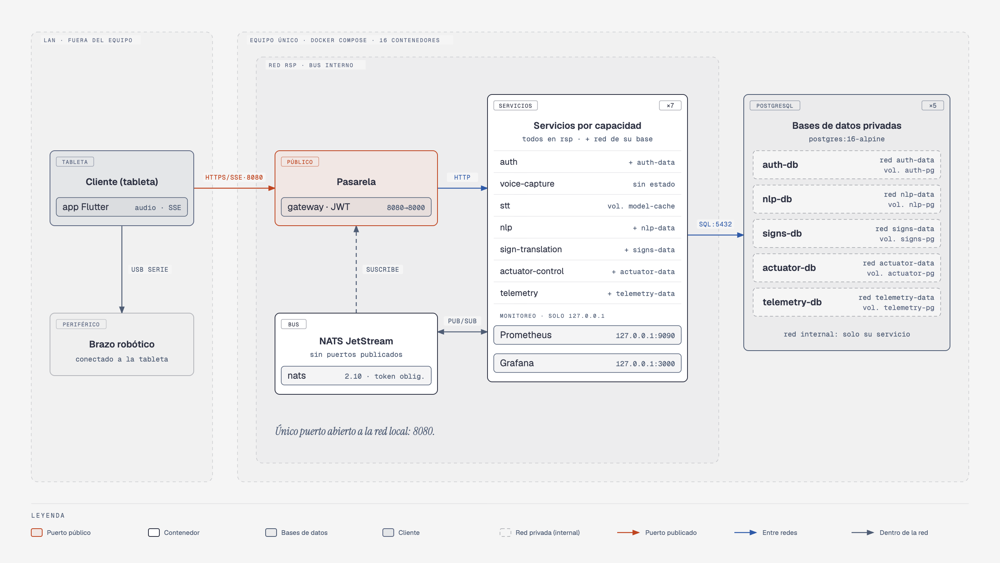
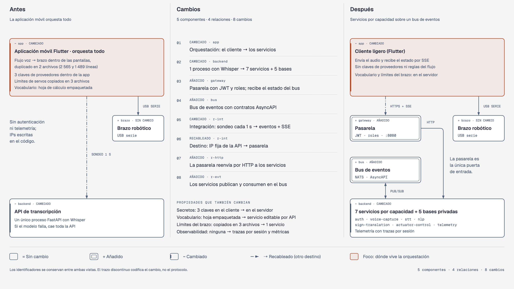

# Arquitectura

Documento de arquitectura de la plataforma, con estructura arc42 abreviada. Distingue dos niveles:

- **La arquitectura de referencia (§4 a §6):** servicios por capacidad, contratos de eventos y decisiones, aplicables a otros robots que traduzcan voz a señas.
- **La instancia (§7):** el prototipo de este repositorio, desplegado para un brazo robótico de 15 servomotores. La referencia se ha validado en una sola instancia; su reutilización en otros robots es una hipótesis.

Cada decisión está registrada en [`adr/`](adr/).

## Contenido

1. [Objetivos y atributos de calidad](#1-objetivos-y-atributos-de-calidad)
2. [Restricciones](#2-restricciones)
3. [Contexto](#3-contexto)
4. [Contenedores](#4-contenedores)
5. [Ejecución de una sesión](#5-ejecución-de-una-sesión)
6. [Conceptos transversales](#6-conceptos-transversales)
7. [Despliegue de la instancia](#7-despliegue-de-la-instancia)
8. [De la arquitectura anterior a la propuesta](#8-de-la-arquitectura-anterior-a-la-propuesta)
9. [Decisiones de arquitectura](#9-decisiones-de-arquitectura)
10. [Riesgos y deuda técnica](#10-riesgos-y-deuda-técnica)
11. [Glosario](#11-glosario)

## 1. Objetivos y atributos de calidad

El objetivo es separar las etapas de la cadena voz → seña para que cada una pueda sustituirse, escalarse y observarse por separado. Los atributos de calidad, en orden de prioridad:

| Prioridad | Atributo | Por qué importa en este dominio |
|---|---|---|
| 1 | Modificabilidad | Los motores de reconocimiento, el vocabulario y el hardware cambian a ritmos distintos |
| 2 | Rendimiento (latencia) | Una conversación tolera alrededor de un segundo de retardo |
| 3 | Interoperabilidad | Clientes y hardware heterogéneos |
| 4 | Observabilidad | Sin mediciones no hay evaluación ni diagnóstico en campo |
| 5 | Disponibilidad | Un fallo del reconocimiento no debe dejar el robot inerte |
| 6 | Seguridad | Secretos fuera de los clientes y acceso autenticado a los actuadores |

Los doce escenarios que concretan estos atributos están en [escenarios-de-calidad.md](escenarios-de-calidad.md).

## 2. Restricciones

- Brazo existente de 15 servos con *firmware* serie sin confirmación de ejecución, que no puede modificarse a corto plazo.
- Despliegue en un equipo junto al robot, con Docker y sin dependencia de la nube salvo proveedores opcionales.
- Equipo pequeño y un único lenguaje, Python ([ADR-001](adr/ADR-001-estilo-microservicios-python.md)).
- El vocabulario de señas lo mantienen personas no técnicas.

## 3. Contexto

La persona usuaria habla o escribe en un cliente (la aplicación de la tableta), que envía el audio o el texto a la plataforma por HTTPS y recibe por SSE el plan de gestos. El cliente reenvía los ángulos al brazo por USB serie. El equipo lingüístico mantiene el vocabulario por la API, y el monitoreo lee las métricas de todos los servicios.

## 4. Contenedores

### 4.1 Catálogo de servicios

| Servicio | Responsabilidad | Consume | Publica | Datos propios |
|---|---|---|---|---|
| Pasarela (`gateway`) | Frontera: autenticación, enrutamiento, SSE por sesión, salud agregada | HTTP de los clientes; `actuator.state` | HTTP, SSE | — |
| Autenticación (`auth`) | Identidad y emisión de tokens | HTTP | JWT | Usuarios (PostgreSQL) |
| Captura de voz (`voice-capture`) | Ingesta y normalización de audio o texto | HTTP | `voice.audio.chunk`, `voice.text.transcribed` | — |
| Reconocimiento (`stt`) | Audio → texto, con proveedor intercambiable | `voice.audio.chunk` | `voice.text.transcribed` | Caché de modelos |
| Procesamiento lingüístico (`nlp`) | Traducción kichwa–español y glosado | `voice.text.transcribed` | `nlp.gloss.sequence` | Diccionario (PostgreSQL) |
| Traducción a señas (`sign-translation`) | Glosas → plan de gestos; vocabulario | `nlp.gloss.sequence` | `signs.gesture.plan` | Señas (PostgreSQL) |
| Control de actuadores (`actuator-control`) | Ejecución segura: límites y *drivers* | `signs.gesture.plan` | `actuator.state` | Modelo del hardware (PostgreSQL) |
| Telemetría (`telemetry`) | Trazas por sesión, latencias y métricas | Todos los asuntos | API, `/metrics` | Eventos (PostgreSQL) |

**Regla de la referencia:** cada servicio es dueño de un único tipo de conocimiento —el hardware, el vocabulario, el motor de voz— y lo expone solo a través de su contrato. Las únicas llamadas síncronas entre servicios son las de la pasarela y una consulta opcional del reconocimiento al vocabulario ([ADR-004](adr/ADR-004-contratos-primero.md)).

### 4.2 Contratos de eventos

| Asunto | Productor | Consumidores | Notas |
|---|---|---|---|
| `voice.audio.chunk` | Captura de voz | Reconocimiento | Persistido en JetStream, antigüedad máxima de 30 s ([ADR-010](adr/ADR-010-ingreso-durable.md)) |
| `voice.text.transcribed` | Reconocimiento; Captura (texto escrito) | Procesamiento lingüístico | El texto escrito no pasa por el reconocimiento |
| `nlp.gloss.sequence` | Procesamiento lingüístico | Traducción a señas | Secuencia de glosas |
| `signs.gesture.plan` | Traducción a señas | Control de actuadores | Gestos con sus 15 ángulos |
| `actuator.state` | Control de actuadores | Pasarela | `accepted`, `executing`, `done`, `failed` |
| `telemetry.event` | Cualquier servicio | Telemetría | Eventos de diagnóstico |

La especificación completa está en [`contracts/asyncapi.yaml`](../contracts/asyncapi.yaml).

## 5. Ejecución de una sesión

Cada evento arrastra una traza acumulada con siete marcas de tiempo (`captured`, `transcribed`, `glossed`, `planned`, `accepted`, `executing`, `done`) ([ADR-003](adr/ADR-003-pipeline-por-eventos-y-trazas.md), [ADR-012](adr/ADR-012-traza-acumulativa.md)). La latencia de extremo a extremo y por etapa se obtiene del propio evento final, sin instrumentación externa. En un solo equipo no hace falta sincronizar relojes; con varios, se requiere NTP.

## 6. Conceptos transversales

- **Contratos primero.** Los esquemas Pydantic de [`libs/rsp_common`](../libs/rsp_common) son el contrato; un cambio incompatible exige un asunto versionado.
- **Colas de trabajo.** Las etapas consumen con un grupo de cola; añadir réplicas del reconocimiento no requiere cambiar código ([ADR-009](adr/ADR-009-consumo-concurrente.md)).
- **Salud y métricas uniformes.** Todo servicio expone `/health` y `/metrics` a través del servicio base común.
- **Seguridad en el borde.** Solo la pasarela es alcanzable desde la red; JWT con roles ([ADR-006](adr/ADR-006-seguridad-en-el-borde.md), [ADR-011](adr/ADR-011-autorizacion-por-rol.md)).
- **Degradación controlada.** Si el reconocimiento cae, el modo texto sigue operativo y el audio recibido se conserva durante 30 s.
- **Proveedores como estrategia.** Reconocimiento, traducción y *driver* del actuador se eligen por configuración ([ADR-007](adr/ADR-007-proveedores-como-estrategia.md)).
- **Datos por servicio.** Cada servicio con estado tiene su base de datos en una red privada ([ADR-014](adr/ADR-014-base-de-datos-por-servicio.md)).

## 7. Despliegue de la instancia

La instancia se despliega con Docker Compose en un solo equipo: 16 contenedores, que son los ocho servicios, el bus, Prometheus, Grafana y cinco bases PostgreSQL. La configuración y la operación se describen en [operacion.md](operacion.md).

## 8. De la arquitectura anterior a la propuesta

El sistema anterior concentraba la orquestación en la aplicación móvil y el reconocimiento en un único proceso de API. La propuesta traza las fronteras por capacidad del dominio y no por tecnología.

## 9. Decisiones de arquitectura

| ADR | Decisión |
|---|---|
| [001](adr/ADR-001-estilo-microservicios-python.md) | Microservicios con un único lenguaje (Python) |
| [002](adr/ADR-002-bus-de-eventos-nats.md) | NATS como bus de eventos |
| [003](adr/ADR-003-pipeline-por-eventos-y-trazas.md) | Cadena asíncrona por eventos con trazas de tiempo |
| [004](adr/ADR-004-contratos-primero.md) | Contratos de eventos como dependencia entre servicios |
| [005](adr/ADR-005-unico-dueno-del-hardware.md) | Control de actuadores como único dueño del modelo del hardware |
| [006](adr/ADR-006-seguridad-en-el-borde.md) | Pasarela como frontera de seguridad |
| [007](adr/ADR-007-proveedores-como-estrategia.md) | Proveedores intercambiables |
| [008](adr/ADR-008-vocabulario-de-senas-como-servicio.md) | Vocabulario de señas como servicio |
| [009](adr/ADR-009-consumo-concurrente.md) | Consumo concurrente e inferencia fuera del bucle de eventos |
| [010](adr/ADR-010-ingreso-durable.md) | Ingreso de audio durable |
| [011](adr/ADR-011-autorizacion-por-rol.md) | Autorización por rol |
| [012](adr/ADR-012-traza-acumulativa.md) | Traza acumulativa en todos los eventos |
| [013](adr/ADR-013-sesgo-por-vocabulario.md) | Tope de salida del reconocimiento |
| [014](adr/ADR-014-base-de-datos-por-servicio.md) | Base de datos por servicio |

Las ADR 009 a 013 surgieron de la evaluación.

## 10. Riesgos y deuda técnica

| Riesgo | Mitigación o estado |
|---|---|
| El protocolo serie no confirma la ejecución: `done` significa «enviado», no «ejecutado» | Trabajo futuro: *firmware* con confirmación o lectura de posición |
| La reutilización de la referencia se ha probado en una sola instancia | Una segunda instancia o una evaluación por expertos |
| En un solo equipo, las réplicas del reconocimiento compiten por la CPU | Repartir réplicas en varios nodos o usar GPU |
| Las reglas de glosado son simples y el vocabulario no está validado por intérpretes | Fuera del alcance de la arquitectura; el contrato permite sustituir el procesamiento lingüístico |
| Los dueños de las sesiones se guardan en memoria de la pasarela | Persistirlos si la pasarela se replica |

## 11. Glosario

| Término | Definición |
|---|---|
| Glosa | Etiqueta en mayúsculas que nombra una seña del vocabulario |
| Deletreo (dactilología) | Representación de una palabra letra a letra con el alfabeto manual |
| Plan de gestos | Secuencia ordenada de posiciones objetivo de los servos |
| Traza | Marcas de tiempo por etapa que viajan dentro de cada evento |
| Vista previa (`dry_run`) | Sesión que produce y acepta el plan sin mover el brazo |
