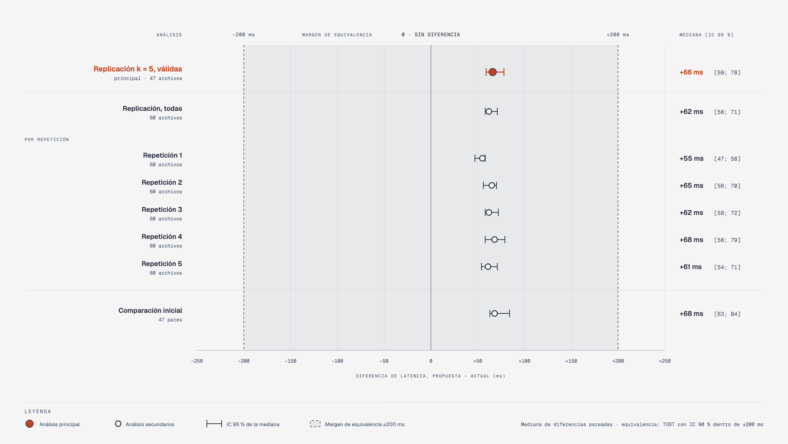
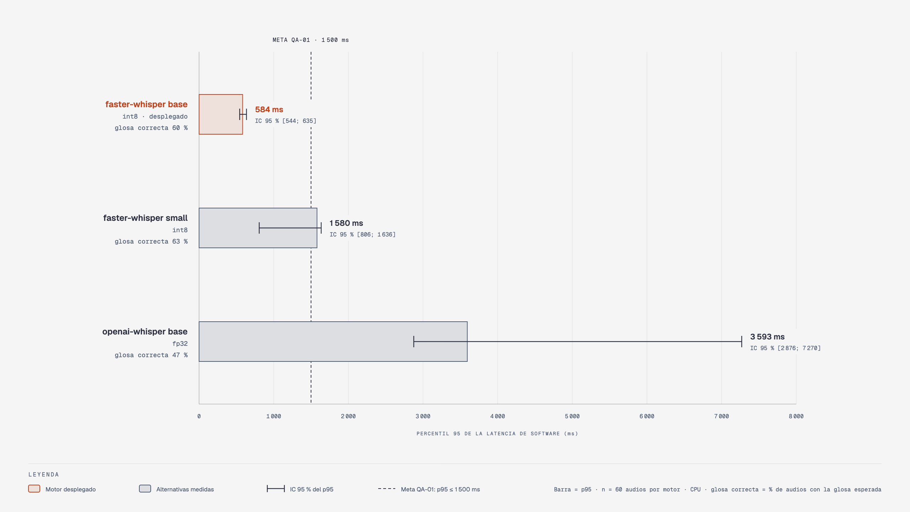
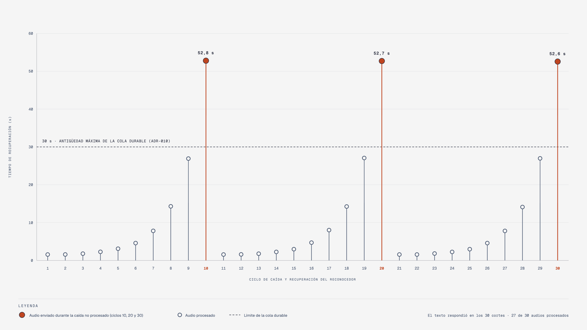
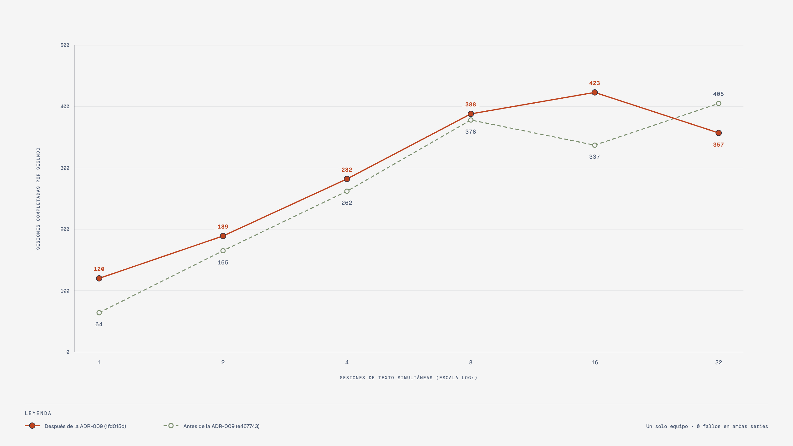

# Evaluación

Resultados de los escenarios de calidad definidos en [escenarios-de-calidad.md](escenarios-de-calidad.md). Todas las mediciones se hicieron en un solo equipo (Apple M4 Pro, 12 núcleos) con los guiones de [`scripts/`](../scripts); los datos crudos están en [`results/`](../results), y cada archivo registra el *commit* del sistema medido y de los instrumentos.

## Contenido

1. [Resumen por escenario](#1-resumen-por-escenario)
2. [Latencia frente a la arquitectura anterior](#2-latencia-frente-a-la-arquitectura-anterior)
3. [Reconocimiento de voz](#3-reconocimiento-de-voz)
4. [Disponibilidad](#4-disponibilidad)
5. [Escalabilidad](#5-escalabilidad)
6. [Límites de la evaluación](#6-límites-de-la-evaluación)

## 1. Resumen por escenario

De los once escenarios del alcance aprobado, siete se cumplieron, dos se cumplieron parcialmente, uno no se cumplió y uno no pudo evaluarse con su medida de respuesta (con ella, no se cumpliría). QA-07, de escalabilidad, quedó fuera del alcance aprobado y se reporta como exploratorio.

| ID | Atributo | Resultado | Veredicto |
|---|---|---|---|
| QA-01 | Rendimiento | Texto: p95 de 2 ms. Voz: p95 de 584 ms (IC 95 % 544–635), 604 ms con 300 sesiones. Con el mismo código de reconocimiento, +66 ms frente a la arquitectura anterior, equivalente dentro de ±200 ms | Cumple |
| QA-02 | Rendimiento | En el brazo real, envío de cada configuración en 1 106 ms (mediana) frente a 1 008 ms del envío servo a servo anterior (+10 %). El envío anterior manda el ángulo final de cada servo de una vez y termina mientras el brazo aún se mueve a saltos; la trayectoria suave reparte el envío a lo largo del movimiento. La medida compara envíos, no la duración de la seña | No evaluable |
| QA-03 | Modificabilidad | Motor de reconocimiento nuevo: 3 archivos de un servicio (+43 líneas), frente a 10 archivos en dos unidades; el límite era 2 archivos | No cumple |
| QA-04 | Modificabilidad | 10 señas añadidas por API en 25 ms; 0 recompilaciones y 0 despliegues | Cumple |
| QA-05 | Modificabilidad | *Driver* nuevo del brazo: 2 archivos del servicio (+32/−3); límites del hardware en 1 archivo, frente a 3 | Cumple |
| QA-06 | Disponibilidad | Reinicio del reconocimiento en 1,0 s con 260/260 sesiones; corte de 16 s con texto 52/52. Con el reconocedor real: texto 30/30 y audio 27/30 | Parcial |
| QA-07 | Escalabilidad | Meta: p95 al menos un 40 % menor con 3 réplicas. No se midió con 3; con 2, sin ganancia (voz: 3,8 frente a 3,6 sesiones/s). Texto: 32 sesiones simultáneas sin fallos, hasta 423 sesiones/s | Exploratorio (fuera del alcance); meta no alcanzada |
| QA-08 | Observabilidad | Siete marcas en las sesiones con ejecución; cinco en vista previa, por diseño | Parcial |
| QA-09 | Seguridad | 60/60 peticiones sin credencial válida rechazadas (401); 8/8 sin rol (403); 7 servicios internos inaccesibles; 0 claves en clientes | Cumple |
| QA-10 | Interoperabilidad | Un cliente de línea de comandos usa la plataforma por HTTP y SSE sin cambios en el servidor | Cumple |
| QA-11 | Mantenibilidad | Módulo más grande: 229 líneas en la plataforma y 398 en el cliente; 0 importaciones entre servicios | Cumple |
| QA-12 | Fiabilidad | 10/10 palabras sin seña con la brecha registrada, tras corregir dos defectos | Cumple |

## 2. Latencia frente a la arquitectura anterior

La comparación ejecuta en ambas arquitecturas el mismo código de reconocimiento, de modo que la diferencia es atribuible a la arquitectura en esta configuración, con el reconocimiento fuera de contenedores. Se replicó con un plan registrado antes de medir ([plan-replica-qa01.md](plan-replica-qa01.md)): cinco repeticiones de los 60 audios, con el orden de los audios y de los sistemas al azar, 600 mediciones en total.

La propuesta fue 66 ms más lenta en la mediana de las diferencias pareadas (IC 95 % 59–78 ms; IC 90 % 59–77 ms), dentro del margen de equivalencia de ±200 ms. Las cinco repeticiones dieron por separado entre 55 y 68 ms, y la comparación inicial, +68 ms. La traza de los eventos permite descomponer la diferencia (47 pares de la comparación inicial, medianas):

| Tramo | Diferencia |
|---|---|
| Reconocimiento en la propuesta, de la captura al texto y con el paso por el bus, frente a la petición completa anterior | +3 ms (−0,3 ms en los 31 pares con transcripciones idénticas) |
| Glosado, plan y aceptación | 5 ms |
| Fuera de la traza: creación de la sesión, flujo SSE, subida por la pasarela, normalización y entrega del evento final | 62 ms |

El costo, obtenido por diferencia y no medido directamente, parece proceder de las idas y vueltas HTTP de la sesión, no del bus ni de las etapas añadidas. La equivalencia se refiere a la latencia típica (mediana), no a las colas: en el p95, sin contraste, la propuesta dio 4 072 ms frente a 2 168 ms.

## 3. Reconocimiento de voz

Con *faster-whisper base* el reconocimiento explica más del 99 % de la latencia de software; las etapas propias de la arquitectura suman unos 2 ms en la mediana. *faster-whisper small* mejora poco la exactitud y su p95 supera la meta. El tope de salida de la [ADR-013](adr/ADR-013-sesgo-por-vocabulario.md) bajó el p95 de 1 195 a 584 ms sin diferencia detectable en la exactitud. La «glosa correcta» mide si la secuencia de glosas coincide con la de la referencia; no evalúa la forma de la seña.

## 4. Disponibilidad

Con el reconocedor real, en 30 ciclos de caída y recuperación, el modo texto respondió en todos los cortes y se procesaron 27 de los 30 audios enviados durante la caída. La recuperación creció dentro de cada serie de diez ciclos por la espera de la política de reinicio de Docker. Los tres audios perdidos son los de los ciclos 10, 20 y 30, los únicos cuya recuperación superó la antigüedad máxima de 30 s de la cola durable ([ADR-010](adr/ADR-010-ingreso-durable.md)). En ráfagas de 30 audios durante una caída de 16 s se procesaron los 90.

## 5. Escalabilidad

La [ADR-009](adr/ADR-009-consumo-concurrente.md) hizo concurrente el consumo del bus y llevó la inferencia a hilos. Medidos con el mismo instrumento, en un solo equipo el cambio no mejoró el rendimiento de forma consistente, y una segunda réplica del reconocimiento tampoco, porque ambas compiten por la misma CPU. El escenario es exploratorio, porque el anteproyecto dejó la escalabilidad fuera del alcance, y su meta no se alcanzó; no hubo fallos y añadir réplicas no exigió cambiar código. No demuestra escalabilidad horizontal.

## 6. Límites de la evaluación

- **Un solo equipo.** No incluye la latencia de red entre nodos.
- **Corpus sintético.** 60 grabaciones de 20 expresiones con tres voces sintéticas en español; no incluye kichwa ni hablantes reales.
- **Brazo real.** Se midió el envío de cada configuración, no su ejecución física, porque el protocolo serie no la confirma. Por eso QA-02 no puede evaluarse: comparar tiempos de envío entre un perfil de saltos y uno suave no dice cuál termina antes la seña; hace falta medir el movimiento, por ejemplo con vídeo de alta velocidad.
- **Vocabulario.** La mayoría de las señas no está validada por intérpretes; la evaluación mide atributos del software, no la calidad de la traducción ni su utilidad para la comunidad sorda.
- **Una instancia.** La arquitectura de referencia se evaluó en un solo robot; su reutilización en otros es una hipótesis.
- **Sin comparación con un monolito modular.** La arquitectura propuesta es de microservicios; la evaluación no la comparó con un monolito modular de las mismas fronteras, de modo que la mayoría de los resultados se atribuyen a dónde se trazan las fronteras y no al número de procesos.
