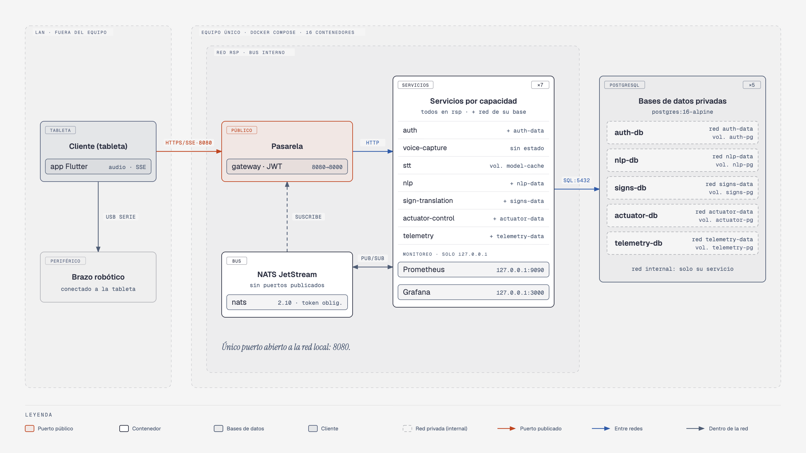
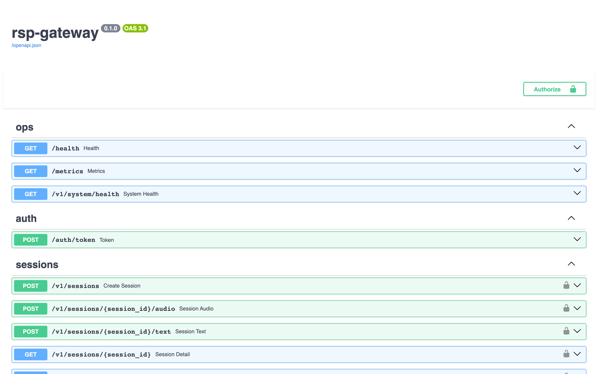
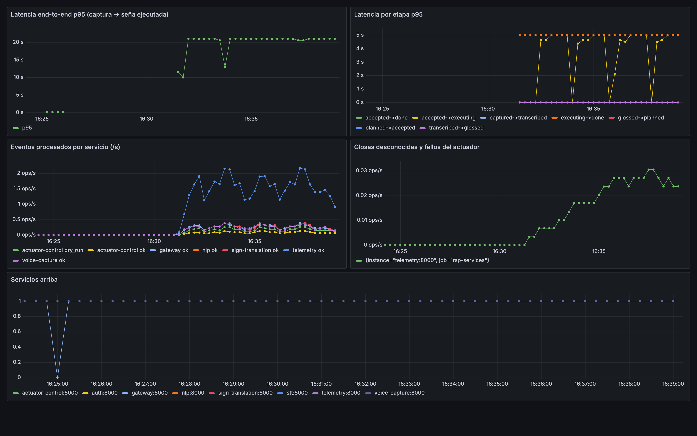

# Guía de operación

Cómo configurar, desplegar, observar y diagnosticar la plataforma. La arquitectura se describe en [arquitectura.md](arquitectura.md).

## Contenido

1. [Requisitos](#1-requisitos)
2. [Configuración](#2-configuración)
3. [Despliegue con Docker Compose](#3-despliegue-con-docker-compose)
4. [Reconocimiento de voz](#4-reconocimiento-de-voz)
5. [Brazo robótico real](#5-brazo-robótico-real)
6. [Ejecución sin Docker](#6-ejecución-sin-docker)
7. [API](#7-api)
8. [Observabilidad](#8-observabilidad)
9. [Seguridad](#9-seguridad)
10. [Pruebas](#10-pruebas)
11. [Solución de problemas](#11-solución-de-problemas)
12. [Diferencias con el repositorio de desarrollo](#12-diferencias-con-el-repositorio-de-desarrollo)

## 1. Requisitos

| Componente | Versión | Uso |
|---|---|---|
| Docker y Docker Compose | Compose v2 | Despliegue de los 16 contenedores |
| Python | 3.11 | Guiones de demostración, evaluación y pruebas |
| `jq`, `curl`, `openssl` | — | Ejemplos de la API y generación de claves |
| macOS | — | Solo para regenerar los corpus de voz (`say`, `afconvert`) |

## 2. Configuración

Toda la configuración se lee de `.env` (plantilla en [`.env.example`](../.env.example)). Las variables marcadas como obligatorias no tienen valor por defecto: Compose se niega a arrancar si faltan.

| Variable | Obligatoria | Valor por defecto | Descripción |
|---|---|---|---|
| `AUTH_SECRET` | sí | — | Clave de firma de los JWT (HS256), 32 bytes o más: `openssl rand -hex 32` |
| `BUS_TOKEN` | sí | — | Credencial del bus NATS |
| `AUTH_USERS` | sí | — | Usuarios iniciales `usuario:clave:rol1\|rol2`, separados por comas; se siembran una sola vez en la base del servicio de autenticación |
| `GATEWAY_PORT` | no | `8080` | Puerto publicado de la pasarela |
| `GRAFANA_PORT` | no | `3000` | Puerto de Grafana, publicado solo en `127.0.0.1` |
| `STT_PROVIDER` | no | `echo` | `echo` (sin modelo, transcribe el texto de prueba), `whisper` (*faster-whisper*), `kichwa` |
| `WHISPER_MODEL` | no | `base` | Tamaño del modelo de Whisper |
| `STT_REPLICAS` | no | `1` | Réplicas del servicio de reconocimiento |
| `TRANSLATION_PROVIDER` | no | `dictionary` | `none`, `dictionary` o `google` |
| `ACTUATOR_DRIVER` | no | `simulator` | `simulator` o `serial` |
| `SIM_INTER_COMMAND_MS` | no | `150` | Espera del simulador entre comandos; `0` mide solo la arquitectura |
| `*_DB_PASSWORD` | no | `dev-…` | Contraseña de la base de cada servicio; cámbiela en cualquier despliegue real |
| `LOG_LEVEL` | no | `INFO` | Con `DEBUG`, el servicio lingüístico registra también el texto dicho |

## 3. Despliegue con Docker Compose

```bash
docker compose up --build -d      # o: make up
docker compose ps                 # 16 contenedores en estado healthy
python scripts/e2e_demo.py "hola mamá"
docker compose down -v            # detiene y borra los volúmenes
```

Si cambia el puerto de la pasarela, indíquelo también a los guiones: `GATEWAY_PORT=8081 docker compose up -d` y `GATEWAY=http://127.0.0.1:8081 python scripts/e2e_demo.py "hola"`.

<p align="center"></p>

Solo la pasarela publica un puerto hacia la red. Prometheus y Grafana se publican en `127.0.0.1`, y cada base de datos comparte una red privada únicamente con su servicio.

## 4. Reconocimiento de voz

Por defecto el reconocimiento usa `echo`, que no carga ningún modelo y sirve para probar la plataforma y medir la arquitectura. Para voz real:

```bash
make up-voz        # faster-whisper small con el vocabulario kichwa como sesgo
# o, con el modelo base:
STT_PROVIDER=whisper docker compose -f docker-compose.yml -f docker-compose.whisper.yml up --build -d
```

`docker-compose.whisper-openai.yml` levanta el proveedor *openai-whisper* (PyTorch, fp32). Los guiones de evaluación vuelven a dejar el reconocimiento en `echo`; tras una evaluación, ejecute `make up-voz` de nuevo.

## 5. Brazo robótico real

El brazo se conecta por USB serie. En Linux, configure `ACTUATOR_DRIVER=serial` y `SERIAL_PORT=/dev/ttyUSB0` en `.env` y habilite `devices:` en el servicio `actuator-control` de `docker-compose.yml`.

Docker Desktop para macOS no expone los puertos USB a los contenedores; el servicio de actuadores se ejecuta entonces de forma nativa y el resto en Docker:

```bash
python3 scripts/serial_probe.py                                              # lista los puertos serie
python3 scripts/serial_probe.py /dev/tty.usbserial-XXXX --servo 12 --angle 100   # prueba directa de un servo
scripts/run_actuator_native.sh /dev/tty.usbserial-XXXX                       # actuador nativo + pasarela redirigida
python3 scripts/e2e_demo.py "hola"
```

Con el brazo conectado a una tableta, el cliente hace de puente: recibe el plan por SSE y envía los ángulos al *firmware*. `scripts/doctor.sh` comprueba los requisitos, construye, levanta y ejecuta la demostración en un solo paso.

## 6. Ejecución sin Docker

Útil para desarrollo o integración continua; requiere `nats-server` en el `PATH`.

```bash
pip install -e libs/rsp_common -r services/gateway/requirements.txt pyserial
export AUTH_SECRET=$(openssl rand -hex 32)
scripts/run_local.sh start
python scripts/e2e_demo.py "tengo 4 manzanas"
scripts/run_local.sh stop
```

## 7. API

La pasarela publica su especificación OpenAPI en `/openapi.json` y una interfaz interactiva en `/docs`.

<p align="center"></p>

| Ruta | Rol | Descripción |
|---|---|---|
| `POST /auth/token` | — | Inicio de sesión; devuelve un JWT |
| `POST /v1/sessions` | operator | Crea una sesión y la asocia a quien la crea |
| `GET /v1/sessions/{id}/events` | dueño o admin | Flujo SSE con los eventos de la sesión |
| `POST /v1/sessions/{id}/text` · `/audio` | dueño (operator) | Envía texto o un archivo WAV |
| `GET /v1/sessions/{id}` | dueño o admin | Línea de tiempo y latencias de la sesión |
| `GET·PUT·DELETE /v1/signs/…` | usuario autenticado; escribir exige operator | Vocabulario de señas |
| `GET /v1/telemetry/summary` | usuario autenticado | Resumen de latencias |
| `GET /v1/system/health` | — | Salud agregada de todos los servicios |

Los eventos del bus y sus esquemas están en [`contracts/asyncapi.yaml`](../contracts/asyncapi.yaml).

## 8. Observabilidad

Cada evento lleva una traza acumulada con siete marcas (`captured`, `transcribed`, `glossed`, `planned`, `accepted`, `executing`, `done`); el servicio de telemetría calcula con ellas la latencia de cada etapa sin instrumentación externa. Todos los servicios exponen `/metrics` para Prometheus, y Grafana carga el tablero `rsp-pipeline`.

<p align="center"></p>

El tablero muestra la latencia de extremo a extremo y por etapa, los eventos procesados por servicio, las glosas desconocidas, los fallos del actuador y la disponibilidad de cada servicio. La captura es real: 120 sesiones de texto, un tercio de ellas ejecutadas en el brazo simulado, cuya ejecución mecánica domina la latencia de extremo a extremo; la caída de la pasarela a las 16:25 corresponde a un reinicio manual.

## 9. Seguridad

- **Frontera única.** Solo la pasarela es alcanzable desde la red; los servicios internos y el bus no publican puertos.
- **Autenticación y roles.** JWT HS256 con roles `viewer`, `operator` y `admin` ([ADR-006](adr/ADR-006-seguridad-en-el-borde.md), [ADR-011](adr/ADR-011-autorizacion-por-rol.md)). La clave solo la tienen los servicios que verifican tokens.
- **Aislamiento de sesiones.** Una sesión, sus eventos y su telemetría solo son accesibles para quien la creó o para un administrador; la lista de todas las sesiones es solo para administradores.
- **Secretos.** Sin valores por defecto para la clave de firma, el token del bus ni los usuarios; ningún cliente contiene claves de proveedores.
- **Registros.** El texto dicho por el usuario solo se registra con `LOG_LEVEL=DEBUG`.
- **Datos.** Cada base de datos está en una red privada con su servicio ([ADR-014](adr/ADR-014-base-de-datos-por-servicio.md)).

## 10. Pruebas

```bash
python -m pytest -q        # 169 pruebas unitarias; no requieren red, bus ni contenedores
```

## 11. Solución de problemas

| Síntoma | Causa probable | Solución |
|---|---|---|
| `required variable AUTH_SECRET is missing` | Falta una variable obligatoria | Complete `AUTH_SECRET`, `BUS_TOKEN` y `AUTH_USERS` en `.env` |
| `port is already allocated` en la pasarela | El puerto 8080 está ocupado | `GATEWAY_PORT=8081` y `GATEWAY=http://127.0.0.1:8081` para los guiones |
| Un servicio no pasa a `healthy` | La base de datos aún no acepta conexiones | `docker compose logs <servicio>`; el servicio reintenta al arrancar |
| La sesión no recibe eventos | El flujo SSE se abrió después de enviar el texto | Abra `/events` antes de enviar; `e2e_demo.py` lo hace en ese orden |
| El brazo no se mueve en macOS | Docker no expone el USB | Ejecute el actuador de forma nativa (§5) |
| HTTP 404 al consultar una sesión | La sesión es de otro usuario o la pasarela se reinició | Cree una sesión nueva con el mismo token |

## 12. Diferencias con el repositorio de desarrollo

- `data/signs_seed.json` y `data/kichwa_dictionary.json` son datos de ejemplo sintéticos. La plataforma arranca y las pruebas pasan con ellos, pero los resultados de exactitud y de QA-12 requieren los datos originales ([data/README.md](../data/README.md)).
- Las pruebas `test_seed_file_is_valid` y `test_gloss_and_dictionary_endpoints`, que comprobaban el tamaño de esos datos, se ajustaron al de los datos de ejemplo.
- Los audios del corpus se regeneran con `scripts/generate_audio_corpus.sh`; `data/audio_sha256.txt` contiene las sumas de los originales.
- El proveedor `kichwa` del reconocimiento y la línea base de la arquitectura anterior requieren el código de esa arquitectura, que no es público.
- Incluye un endurecimiento de seguridad posterior a la evaluación: credenciales obligatorias, aislamiento de sesiones y de su telemetría, y la clave del traductor externo enviada en cabecera.
